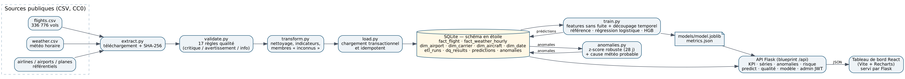

# Module « Ponctualité & prédiction des retards » — extension data/IA de la plateforme ONDA

> **Projet personnel** réalisé en 2026 par Achraf Abderrazik pour prolonger son stage de 2025 à l'ONDA, où il a développé
> une plateforme web aéroportuaire (React + API REST Flask + SQLAlchemy + JWT).
> Il fonctionne sur des **données publiques réelles** (vols au départ de New York en 2013, US Bureau of Transportation
> Statistics, via le package nycflights13, licence CC0). **Ce n'est ni un produit de l'ONDA, ni un module déployé à l'ONDA**,
> et il ne contient aucun code ni aucune donnée du stage.
> Développé avec l'aide d'un assistant IA de programmation ; tous les résultats ci-dessous sont reproductibles avec
> les commandes de la section 3.

## 1. Problème métier

Une direction des opérations aéroportuaires a besoin de trois choses :

1. des **indicateurs de ponctualité fiables** (OTP15, retard moyen, annulations) par aéroport, compagnie, heure et jour ;
2. une **alerte précoce** sur les vols les plus susceptibles d'être retardés ou annulés, pour prioriser la surveillance ;
3. la **détection automatique des journées anormales** et de leur cause probable (météo ou non).

Utilisateurs visés : responsables des opérations (permanence), relations compagnies, reporting de direction.

## 2. Ce que fait le module

| Brique | Rôle | Résultat mesuré |
|---|---|---|
| Pipeline ETL (`aeroops.etl`) | Télécharge et vérifie les CSV (SHA-256), applique 17 règles de qualité, construit un entrepôt SQLite en étoile, chargement transactionnel et idempotent | 336 776 vols, 26 115 observations météo chargés en ~20 s ; anomalies documentées (voir §5) |
| Modèle de risque (`aeroops.train`) | Probabilité qu'un vol parte avec ≥ 15 min de retard ou soit annulé, calculée avec des informations disponibles avant le départ | ROC-AUC **0,706** en test temporel (référence : 0,660) ; précision 54,9 % sur les 10 % de vols les plus risqués (lift 2,33) |
| Détection d'anomalies (`aeroops.anomalies`) | Journées de perturbation anormale par aéroport (z-score robuste sur 28 jours glissants) + cause probable | 95 journées signalées sur 1 014 ; 77 % ont une météo défavorable (contre 26 % en moyenne) ; tempête de neige des 8–9 février 2013 détectée sur les 3 aéroports |
| API REST Flask (`aeroops.api`) | KPI, séries, anomalies, vols à risque, prédiction, qualité, métriques, administration protégée par JWT | 10 endpoints testés |
| Tableau de bord React | 5 onglets : vue d'ensemble, retards, vols à risque, qualité des données, modèle | servi par Flask, aucune installation de Node nécessaire pour l'utiliser |
| Tests (`pytest`) | ETL, qualité, absence de fuite, modèle, anomalies, API | **21 tests réussis** |



## 3. Démarrage rapide

Prérequis : Python 3.10 ou plus récent (Anaconda convient). Node.js n'est **pas** nécessaire (le tableau de bord est déjà construit dans `dashboard/dist`).

### Windows (PowerShell ou invite de commandes)

```bat
cd 01_ONDA_Extension_Ponctualite
pip install -r requirements.txt
run_all.bat
```

### Linux / macOS

```bash
cd 01_ONDA_Extension_Ponctualite
pip install -r requirements.txt
bash run_all.sh
```

`run_all` enchaîne : ETL → entraînement → anomalies → tests → démarrage de l'API. Ouvrir ensuite
**http://127.0.0.1:5050** dans le navigateur.

### Commandes individuelles

```bash
# Windows : set PYTHONPATH=src     Linux : export PYTHONPATH=src
python -m aeroops.extract       # téléchargement + vérification des empreintes (les CSV sont déjà fournis)
python -m aeroops.etl           # entrepôt SQLite data/warehouse/aeroops.db (+ rapport qualité)
python -m aeroops.train         # modèles, métriques, figures, prédictions oct.–déc.
python -m aeroops.anomalies     # journées anormales + figure
python -m pytest -q             # 21 tests
python -m aeroops.api           # API + tableau de bord sur http://127.0.0.1:5050
```

La base SQLite (≈ 85 Mo) n'est pas livrée : elle est régénérée par l'ETL en une vingtaine de secondes.

## 4. Parcours de démonstration (5 minutes)

1. **Vue d'ensemble** : 336 776 vols, OTP15 77,8 %, taux d'annulation 2,45 % ; la courbe journalière montre les pics
   signalés en rouge. Filtrer sur LGA : la journée du 5 décembre 2013 (visibilité nulle) ressort avec un z robuste de 11.
2. **Retards** : la perturbation augmente au fil de la journée (effet d'accumulation) ; comparaison des compagnies.
3. **Vols à risque** : choisir le 5 décembre 2013 → les vols classés en risque « élevé » avec leurs facteurs de contexte,
   et la colonne « Observé » qui montre ce qui s'est réellement passé.
4. **Qualité des données** : les 17 règles, dont les 4 codes de destination absents du référentiel et les 15 % de vols
   dont l'avion n'est pas référencé — et l'action prise pour chacun.
5. **Modèle** : comparaison référence / régression logistique / gradient boosting, calibration et importance des variables.
6. API : `curl -X POST http://127.0.0.1:5050/api/predict -H "Content-Type: application/json" -d "{\"carrier\":\"UA\",\"origin\":\"EWR\",\"dest\":\"ORD\",\"date\":\"2013-12-05\",\"time\":\"18:30\"}"`

## 5. Résultats (exécution du 30/10/2026)

### Qualité des données (extraits — rapport complet : `reports/data_quality_report.md`)

| Contrôle | Violations | Action |
|---|---:|---|
| Vols sans heure de départ réelle (annulés) | 8 255 (2,45 %) | conservés, comptés comme perturbation |
| Destination absente du référentiel aéroports (4 codes) | 7 602 vols (2,26 %) | ajout de membres « inconnus » dans `dim_airport` |
| Avion absent du référentiel | 50 094 vols (14,99 %) | membres « inconnus » dans `dim_aircraft`, âge NULL |
| Pas d'observation météo à l'heure programmée | 1 556 vols (0,46 %) | variables météo NULL |
| Vitesse de vent aberrante (> 150 mph) | 1 observation | valeur mise à NULL |
| Heure réelle « 2400 » | 29 vols | normalisée à 00:00 du jour suivant |

### Modèle (test = novembre–décembre 2013, 55 403 vols, jamais vu pendant l'entraînement)

| Modèle | ROC-AUC | PR-AUC | Brier | Précision top 10 % | Lift top 10 % |
|---|---:|---:|---:|---:|---:|
| Référence historique (taux compagnie × heure) | 0,660 | 0,355 | 0,1707 | 42,8 % | 1,81 |
| Régression logistique | 0,699 | 0,428 | 0,1628 | 54,8 % | 2,32 |
| **Gradient boosting (HGB), retenu** | **0,706** | **0,448** | **0,1617** | **54,9 %** | **2,33** |

Taux de perturbation : 25,1 % (entraînement), 16,1 % (validation), 23,6 % (test). Détails et limites :
`reports/evaluation_report.md` et `docs/model_card.md`.

### Anomalies

95 journées-aéroport signalées sur 1 014 évaluées ; 76,8 % d'entre elles présentent une météo défavorable, contre 25,9 %
de l'ensemble des journées (×2,96). Les 8 et 9 février 2013 (tempête de neige) sont signalés pour EWR, JFK et LGA.
Liste : `reports/anomalies.csv`.

## 6. Organisation du code

```
src/aeroops/
  config.py        chemins, constantes, découpage temporel
  extract.py       téléchargement, empreintes SHA-256, SOURCES.md
  validate.py      17 règles de qualité -> rapport JSON/Markdown
  transform.py     nettoyage, indicateurs, dimensions (membres « inconnus »)
  load.py          DDL SQLite, chargement transactionnel idempotent, vues KPI
  etl.py           orchestration + audit (etl_runs, dq_results)
  features.py      variables connues avant le départ, encodage cible appris sur l'entraînement
  train.py         référence, régression logistique, HGB, métriques, figures, prédictions
  factors.py       facteurs de contexte lisibles (règles transparentes)
  anomalies.py     z-score robuste glissant + cause probable
  api/             application Flask (blueprint /api) + service de prédiction
dashboard/         React (Vite) + Recharts — source et build (dist/)
tests/             21 tests pytest sur un jeu synthétique isolé
docs/              architecture, fiches données/modèle, API, intégration, décisions, état d'avancement
reports/           rapports et figures générés
```

## 7. Limites (à dire en entretien)

- Données américaines de 2013 : elles servent à démontrer la méthode ; les performances ne se transposent pas telles quelles
  à un autre réseau. `docs/integration_onda.md` décrit le contrat de données à respecter pour d'autres données de vols.
- La météo observée à l'heure programmée joue le rôle d'une prévision à court terme : en production, il faudrait de vraies
  prévisions (résultats probablement un peu moins bons).
- Les facteurs affichés à côté d'un score sont des règles de contexte, pas une décomposition exacte du modèle.
- Pas d'authentification sur les endpoints de lecture (démonstration locale) ; seule l'administration est protégée.

Voir aussi `docs/STATUS.md` (fait / testé / reste à faire) et `docs/decisions.md` (choix techniques et alternatives).
